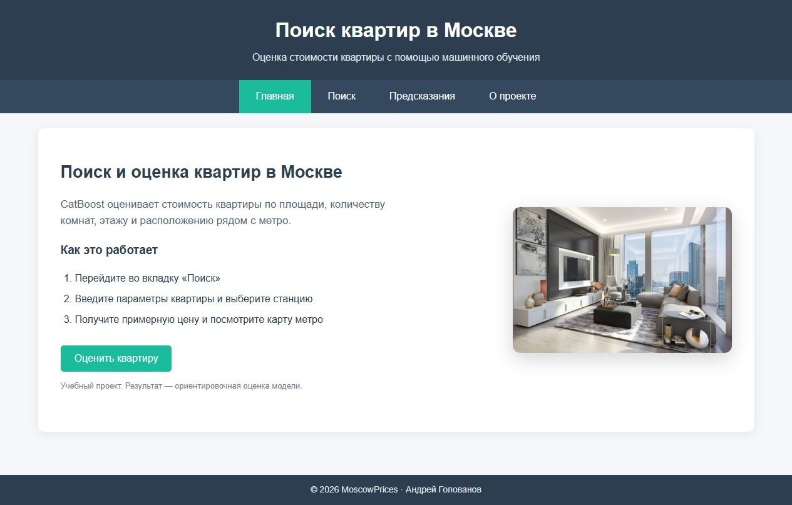
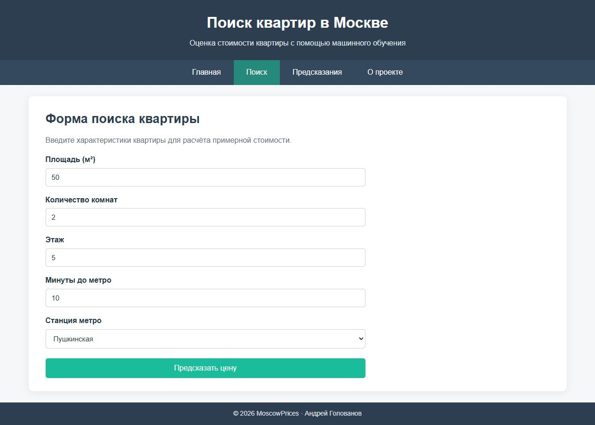
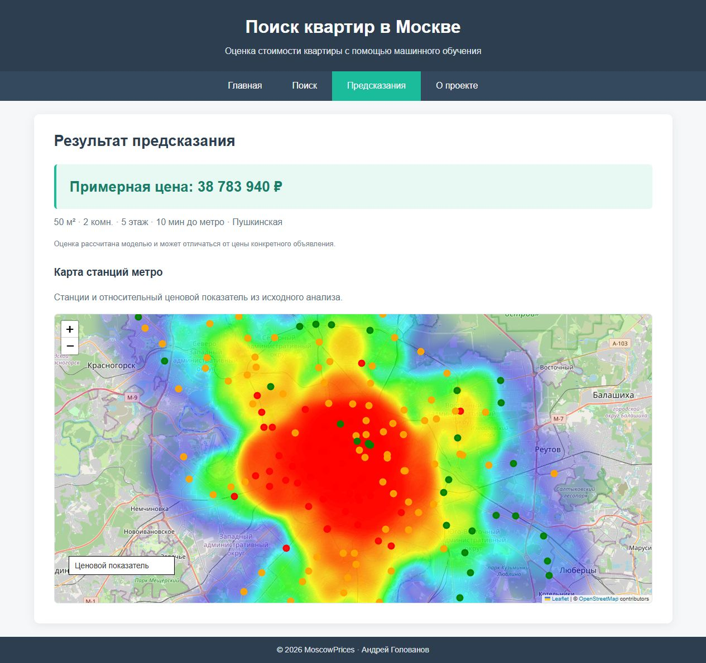
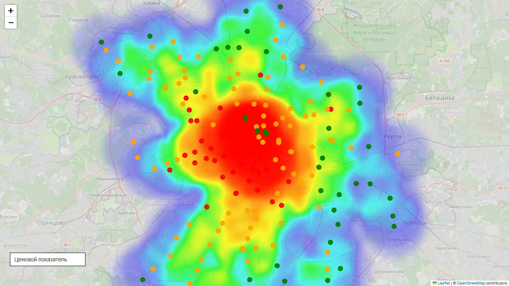

# 🏙️ MoscowPrices — Apartment Price Prediction

Проект по анализу и прогнозированию стоимости квартир в Москве с использованием **CatBoost**. Веб-приложение на **Flask** позволяет задать параметры квартиры, получить примерную цену и посмотреть интерактивную карту метро.

Ноутбук с анализом данных объединён с сайтом из второй лабораторной работы [Spring_2026](https://github.com/golovanov-andrei/Spring_2026/tree/main/Lr2).

---

## 💡 Пример реализации

<table>
  <tr>
    <td width="50%"></td>
    <td width="50%"></td>
  </tr>
  <tr>
    <td align="center"><b>Главная страница</b></td>
    <td align="center"><b>Параметры квартиры</b></td>
  </tr>
  <tr>
    <td></td>
    <td></td>
  </tr>
  <tr>
    <td align="center"><b>Результат предсказания</b></td>
    <td align="center"><b>Карта метро</b></td>
  </tr>
</table>

Скриншоты сделаны на работающем локальном сайте с исходной обученной моделью.

---

## 🚀 Ключевые возможности

- **ML-модель** — CatBoostRegressor оценивает стоимость по характеристикам квартиры и расположению.
- **Веб-интерфейс** — вкладки «Главная», «Поиск», «Предсказания» и «О проекте».
- **Интерактивная форма** — площадь, количество комнат, этаж, время до метро и станция.
- **Карта метро** — Folium / Leaflet, маркеры станций и тепловой слой ценового показателя.
- **Исследование данных** — очистка выбросов, анализ расположения и визуализации в Jupyter Notebook.
- **Общий Flask-сервис** — страницы, ресурсы и API работают на одном адресе.

---

## 🛠 Технологический стек

- **Python 3.12**
- **pandas, NumPy** — обработка данных
- **CatBoost** — регрессия
- **scikit-learn** — разделение выборки и оценка качества в ноутбуке
- **Matplotlib, Seaborn** — визуализация
- **Flask** — сервер и API предсказания
- **HTML, CSS, JavaScript** — интерфейс
- **Folium / Leaflet** — интерактивная карта

---

## 📈 Этапы реализации

### 1. Анализ данных и признаки

В [Prices.ipynb](Prices.ipynb) выполнены исследование распределений, фильтрация выбросов по IQR и анализ цен рядом со станциями метро.

Модель использует пять признаков:

| Признак | Описание |
| --- | --- |
| `Area` | Площадь квартиры |
| `Number of rooms` | Количество комнат |
| `Metro_coef` | Средняя цена объявлений у станции в исходном анализе |
| `Minutes to metro` | Время до метро |
| `Floor` | Этаж |

### 2. Обучение модели

Использован **CatBoostRegressor**: 1 500 деревьев, глубина 10 и learning rate 0.03 в исходном ноутбуке. Целевая переменная преобразуется через `log1p(Price)`, результат — обратно через `expm1`.

Сохранённые результаты ноутбука:

| Метрика | Значение |
| --- | ---: |
| MAE | 1 202 578 ₽ |
| RMSE | 2 388 962 ₽ |
| R² | 0.90 |

<details>
<summary>Об оценке качества</summary>

Числа взяты из опубликованного вывода ноутбука; при объединении сайта модель не переобучалась. В исходном эксперименте Metro_coef рассчитан до разбиения, а test использован при выборе лучшей модели. Для независимой оценки нужно устранить эту утечку и выделить отдельные validation / test. R² не является процентом точности.

</details>

### 3. Веб-приложение

Flask отображает сайт, отдаёт список станций из `metro_coefs.csv` и принимает параметры через `POST /predict`. После расчёта интерфейс переключается на результат. Некорректные значения обрабатываются с понятным сообщением.

---

## 🖥 Использование

### Установка

```bash
git clone https://github.com/golovanov-andrei/MoscowPrices.git
cd MoscowPrices
python -m venv .venv
```

Активируйте окружение:

```powershell
# Windows PowerShell
.\.venv\Scripts\Activate.ps1
```

```bash
# macOS / Linux
source .venv/bin/activate
```

### Подготовка модели и запуск

```bash
python -m pip install -r requirements.txt
python scripts/prepare_model.py
python app.py
```

Откройте **[localhost:5000](http://localhost:5000)**.

Команда подготовки получает исходную модель из архива автора `Spring_2026/Lr2/Moscow.zip` и проверяет контрольные суммы. Для первой загрузки нужен интернет; повторное обучение не требуется. Используется нативный формат CatBoost `.cbm`.

Если архив уже скачан:

```bash
python scripts/prepare_model.py --archive /path/to/Moscow.zip
```

### Анализ и повторное обучение

Откройте [Prices.ipynb](Prices.ipynb) в Jupyter. Для повторного обучения понадобится исходный `data.csv`, которого нет в репозитории; пути Colab в ноутбуке нужно адаптировать к своему окружению. Для просмотра сайта и предсказаний достаточно готовой модели.

### Проверка проекта

```bash
python -m unittest discover -s tests -v
```

Проверяются страницы, ресурсы, список станций, предсказание настоящей моделью и обработка ошибочных запросов. Проверки также запускаются в [GitHub Actions](.github/workflows/site.yml).

---

## 📂 Структура проекта

```text
MoscowPrices/
├── app.py                    # Flask-сайт и API
├── Prices.ipynb              # Исследование и обучение
├── metro_coefs.csv           # Таблица станций и признака Metro_coef
├── templates/                # Страницы и карта
├── static/                   # Стили, JavaScript, иконки, изображение
├── screens/                  # Скриншоты для README
├── scripts/prepare_model.py  # Подготовка исходной модели
├── tests/                    # Проверки объединённого сайта
└── requirements.txt          # Зависимости веб-приложения
```

Модель `catboost_model.cbm` появляется после подготовки и исключена из Git. Карта использует внешний картографический слой; для его отображения нужен интернет.

---

## 👤 Автор

**Андрей Голованов**
[GitHub](https://github.com/golovanov-andrei) · [Telegram](https://t.me/andr3ikaG)
